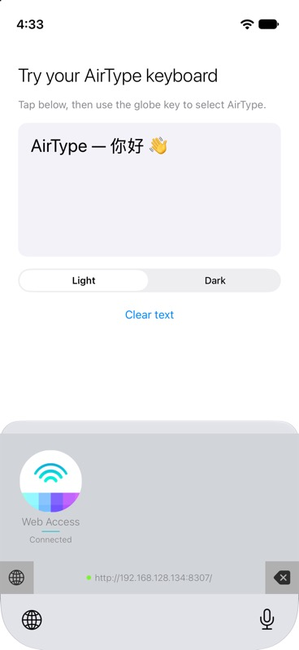
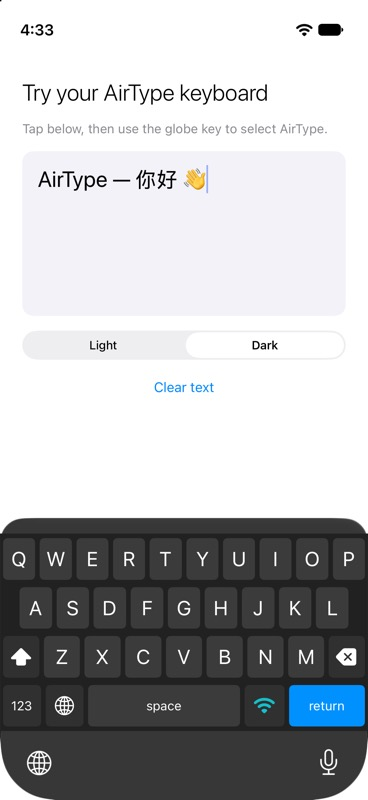

# AirType

Native iOS/iPadOS containing app and keyboard extension recreated from invivo's published AirType design and behaviour. Open `AirType.xcodeproj`, select the **AirType** scheme, and run on an iPhone or iPad. Requires iOS 17 or later. Select your Apple development team for both targets when running on a physical device. The app bundle identifier is `com.invivo.ios.AirType`, and its keyboard extension is `com.invivo.ios.AirType.Keyboard`. `project.yml` preserves these identifiers and the development team selected in Xcode.

## Native nearby typing — developer version

The typing direction is **computer → AirType keyboard extension → the active text field on your iPhone/iPad**. The containing app configures settings and permissions; the visible keyboard owns the receiving connection.

1. Run the **AirTypeDesktop** scheme on your Mac (macOS 14+).
2. Install **AirType** on your iPhone/iPad, add its keyboard and enable **Allow Full Access** under **Keyboard setup**. Grant Local Network access; for Bluetooth, use **Enable Bluetooth access** in the app's Connect tab.
3. In a supported app's text field, switch to AirType. Choose **Direct Wi-Fi** or **Bluetooth** on its connection panel and keep the keyboard visible.
4. In AirType Desktop, choose the matching transport, find the keyboard and enter its **20-character pairing key**. This key is separate from Web Access's six-digit code.
5. Compose text on the Mac and click **Send**. Delete, Return, Tab and left/right cursor controls also operate on the phone's current field.

**Direct Wi-Fi** uses peer-to-peer-enabled Network.framework discovery and connections. Keep Wi-Fi enabled on both devices. Apple may select infrastructure Wi-Fi when available; a no-router radio connection still requires physical-device validation. This is Apple's peer-to-peer networking, rather than generic cross-platform Wi-Fi Direct. **Bluetooth LE** uses a custom GATT service with AirType Desktop as central and the keyboard as peripheral. Pair inside AirType Desktop.

Both native transports authenticate and encrypt commands with AES-GCM, a fresh session challenge and strict sequence numbers. The keyboard holds a random pairing key in memory. The sender waits for acknowledgement, retains uncertain drafts and never automatically resends them. Acknowledgement reports that the keyboard accepted a command; the destination app controls its final editing behavior. The extension does not send surrounding text back to the computer.

Leaving the keyboard or switching to local QWERTY stops receiving. The containing app does not relay text in the background. Bluetooth inside the extension, no-router Wi-Fi, permission prompts and editing in other apps remain physical-device acceptance gates. See [native developer validation](Docs/NEARBY-PLAN.md).

## Features

- Type from a computer browser into an iPhone or iPad over the same Wi-Fi.
- Switch between Web Access and a local QWERTY keyboard with light and dark appearances.
- Send Unicode text, delete a character, or insert a newline remotely.
- Browse six emoji categories or search the offline browser emoji picker; insert choices at the cursor or replace selected draft text before sending.
- Reconnect automatically for up to 10 seconds, then pause until you click Reconnect; retain unsent drafts throughout.
- Pair using the six-digit code shown on the keyboard, or its complete connection URL/QR code; no desktop installation or cloud account is required.

## Screenshots

| Web Access | Dark QWERTY |
| --- | --- |
|  |  |

These screenshots show the installed keyboard extension in the iOS Simulator.

## Requirements

- iOS/iPadOS 17 or later.
- Xcode with an iOS 17-or-later SDK; this project was validated with Xcode 27.
- An Apple development team for installation on physical devices. Enable the App Groups capability and `group.com.invivo.AirTypeReplica` on both targets so the app and keyboard share the custom Bonjour name.
- A computer browser and a shared Wi-Fi network for remote typing.
- XcodeGen only if you want to regenerate the checked-in Xcode project.

## Design reference

AirType recreates invivo's [original AirType app](https://apps.apple.com/us/app/airtype-type-from-your-computer/id922932291), using its public description and screenshots as the design reference. Reference assets are included in [Docs/References](Docs/References). The native setup screen and pairing/QR detail screen support the new implementation.

## Setup

1. Install and open AirType. Tap **Enable local network connection** and permit local network access if prompted. Wait for **Bonjour check passed on this device**. This checks local Bonjour discovery; the computer connection is established separately through the keyboard.
2. Tap **Open Keyboard Settings** on the app page. In AirType settings choose Keyboards and enable AirType. If that option is unavailable, use Settings → General → Keyboard → Keyboards → Add New Keyboard → AirType.
3. Open AirType's keyboard entry and enable **Allow Full Access** for networking. Basic local typing remains available without Full Access.
4. Focus a normal text field and select AirType using the system globe key.
5. Keep your computer and device on the same Wi-Fi. Open the hostname (normally `http://airtype.local:8307/`) or IP address and port shown on the keyboard in your computer browser. The panel first asks for the six-digit **Pairing code** shown beside Web Access. Click **Connect**; once connected, the same panel switches to typing. You can also tap the keyboard address bar to open the complete tokenized URL or QR code; a valid token skips code entry after connection is verified.
6. Type and press Enter or the **paper-plane** Send button. Shift+Enter adds a line break to the draft; the **return-arrow** button sends a newline to the device. The **backspace** button removes one character from the device. Icon buttons include accessible labels and tooltips.

Click **☺ Emoji** below the browser text box to open the emoji picker. Browse Smileys, People, Hearts, Nature, Food, and Activities, or search across all categories using English names. Picking an emoji inserts it into your draft at the cursor (replacing selected text); use Send or Enter when ready. Escape or × closes the picker. All choices are bundled with the portal and work without internet access.

Tap the bottom-left keyboard button to switch to QWERTY; tap the Wi-Fi symbol beside 123/ABC to return to the connection panel. The panel splits status and pairing into equal halves, with a 16-point inset around the connection selector. Its keyboard and delete controls are 44-point circles using native Liquid Glass on iOS 26+, with solid circular backgrounds on earlier versions.

The extension shows a globe only when iOS requests an input-mode switch key; Face ID iPhones normally use the system globe below the keyboard. Local capitalization follows the text field's autocapitalization trait and current context, including Chinese sentence punctuation. Shift toggles case; double-tap Shift locks capitals; 123 and #+= switch symbol pages. Delete acts on touch-down, repeats after one second at 100 ms, and accelerates to 35 ms when dragged left. Release, cancellation, mode changes and leaving the keyboard stop repetition. These basic behaviors were compared with CInput's current keyboard implementation.

Local keys use CInput's 10-point phone / 14-point wide-iPad corner radius. Hold Shift and slide to a letter to insert a capital, or hold it while typing with another finger. Hold 123/ABC or #+= and slide to a character to temporarily type from that page and return to the source page; a tap keeps the selected page. Multi-touch rollover commits older pending letter/space contacts in press order when the next input finger lands, then consumes their later release. Each finger keeps its own ownership through layout changes. Character presses show an enlarged key preview; sliding corrects the selected key, and cancellation inserts nothing.

The bottom row is 123/ABC, Wi-Fi, optional system globe, space, period, return. The original AirType brand remains on the connection panel. Hold space for 0.4 seconds and drag horizontally to move the cursor; release does not insert a space in cursor mode. A 34-point row above the local keys offers on-device English spelling/completion choices using UITextChecker. Tapping a choice replaces only the current matching word and appends a space; automatic replacement and next-word prediction are not enabled. The row respects the text field's spelling setting.

## Bonjour and custom names

The active keyboard advertises `_airtype._tcp` and publishes an IPv4 mDNS hostname, normally `airtype.local`. Open **the complete address shown on the keyboard**, including its port (normally 8307). The six-digit pairing code is still required.

On the app page, edit **Bonjour address** and tap **Save Bonjour Name**. Reopen the keyboard to apply the name. Names are converted to lowercase DNS-safe labels; `.local` is added automatically. If another device owns the name, AirType tries `-2`, `-3`, etc. It displays the successfully registered hostname. If registration is unavailable, the server keeps working by IP; the address detail screen also shows the IP fallback. Bonjour works while Web Access is visible and requires a local network that supports mDNS. Routers and clients that block mDNS should use the IP fallback.

Both targets include the shared App Group entitlement. Use your own unique group identifier consistently in the entitlements and `NetworkPreferences.swift` if you change the bundle identifiers. Custom settings require a properly provisioned App Group on physical devices.

## If the page loads but will not connect

With the original build, opening only the IP and port loaded the public page but omitted the token required to connect. As a workaround for that build, tap the keyboard address bar and use the complete URL, including everything after `#`.

The updated build shows a Pairing code on the keyboard and a Connect form when you open the IP address. Rebuild/reinstall the app and refresh the browser page to use it. An outdated or invalid token also returns to this form. Keep Web Access visible while connecting and typing.

## If the browser cannot open the page

- Open the **AirType app** first and run **Enable local network connection**. If access is blocked, enable AirType under Settings → Privacy & Security → Local Network and return to the app to recheck. Local Network permission and the keyboard's **Allow Full Access** setting are separate.
- Switch to the installed AirType keyboard in a text field and keep **Web Access** visible. The setup screen does not host the typing server.
- Tap the keyboard address strip and try its **IP fallback**, including `http://` and the displayed port. Use the address shown now, because the IP or port may have changed. If IP works but `.local` does not, the problem is hostname discovery.
- Put the computer and iPhone on the same Wi-Fi network. Guest networks, client isolation, or a VPN can prevent devices from reaching one another.
- Toggle to QWERTY and back to Web Access after changing settings. If it still fails, report the keyboard status, address tried, and browser error.

The app checks its own temporary `_airtype._tcp` advertisement and removes it afterward. This does not prove that another device can reach it. Bonjour hostname registration retries after transient failures; IP access remains available when a custom hostname cannot be registered. Actual iOS Local Network permission behavior must be tested on physical hardware, as described in Apple's [local network privacy guidance](https://developer.apple.com/documentation/technotes/tn3179-understanding-local-network-privacy).

## Implementation

- `AirTypeKeyboard/KeyboardViewController.swift`: real keyboard extension using `UITextDocumentProxy`.
- `Shared/AirKeyboardView.swift`: shared UIKit keyboard, light/dark palettes, adaptive extension height, pairing details, QR code, local controls.
- `Shared/LocalKeyboardView.swift` and `LocalKeyboardInteraction.swift`: stable multi-touch surface, per-contact modifiers/rollover, key popups, spelling choices and space cursor control.
- `Shared/AirTypeServer.swift`: Network.framework HTTP server in the active keyboard process, preferred port 8307 with dynamic fallback if occupied, Bonjour advertisement, lifecycle cleanup.
- `Shared/Resources/Portal.html`: bundled offline browser interface with reconnect polling and Unicode/IME-aware Enter handling.
- `Shared/BonjourHostname.swift`: actual mDNS host registration, collision suffixes, and teardown.
- `Shared/NetworkPreferences.swift`: shared custom hostname and DNS-label normalization.
- `Shared/HTTPProtocol.swift`: bounded incremental HTTP parser and validated command model.
- `AirTypeApp`: native setup and both preview/system-keyboard test fields.

The portal exchanges the keyboard-visible six-digit pairing code for a random device-local token, limits incorrect pairing attempts to five per minute, and authenticates commands with that token. It rejects foreign browser origins and deduplicates recently received command IDs. It does not read or send the surrounding text in the host app. HTTP is local and unencrypted: use a trusted network and keep the complete connection address private. Browser drafts remain in the open page, without local storage. An uncertain send retains the draft instead of automatically retrying a possibly delivered command.

The server runs only while Web Access is visible. After a failed connection attempt, the portal retries for up to 10 seconds, then stops requests and displays **Reconnect**. Reopen Web Access and click Reconnect to start another attempt; the draft is retained. If the server returns within the retry window, the portal reconnects automatically. A Wi-Fi address change requires opening the newly displayed address. Other apps can prohibit custom keyboards; iOS substitutes its system keyboard for secure and some phone-number fields. QWERTY is an English letter/symbol layout; arbitrary language text can arrive from the computer. Automatic correction, next-word prediction, and glide typing are not implemented; local spelling/completion choices are available in the row above the keys.

## Build and validation

The native Mac sender uses the **AirTypeDesktop** scheme. On macOS, run the headless native Wi-Fi integration check with:

```sh
scripts/check-nearby-macos.sh
```

It tests actual Bonjour/TCP discovery, encrypted pairing, Unicode delivery and acknowledgement using the shared sender and receiver. To send into the running iOS developer preview, launch AirType with `--native-keyboard-wifi`, then run `scripts/check-nearby-macos.sh --keyboard-preview` and enter the key shown on the preview. This proves preview delivery, separately from installed-extension or Bluetooth hardware acceptance.

The companion landing page lives in [`website/`](website/README.md). It follows invivo's CInput website styling and links to the existing AirType App Store listing. It is a separate static site; the keyboard's bundled Web Access portal remains in `Shared/Resources/Portal.html`.

The checked-in Xcode project is ready to open. `project.yml` can regenerate it using XcodeGen:

```sh
xcodegen generate
xcodebuild -project AirType.xcodeproj -scheme AirType -destination 'platform=iOS Simulator,name=iPhone 17' test
```

Run browser connection-state regression tests with Node.js 18 or later (no packages required):

```sh
node --test Tests/PortalConnectionTests.cjs
```

These exercise the bundled portal script with a controlled clock and transport, including the 10-second cutoff, a server that never responds, manual reconnect, early recovery, pairing failures, and draft retention.

Use launch arguments `--keyboard-demo` for the shared-view preview or `--system-test` for a text field using installed system keyboards. Use `--native-keyboard-wifi` or `--native-keyboard-bluetooth` for native receiving previews. Default launch opens Connect, with Keyboard setup in the second tab.

See [validation results](Docs/VALIDATION.md) for completed checks and physical-device gates, and the [implementation checklist](Docs/PLAN.md) for the design contract.

## Ownership

AirType branding and original reference artwork belong to invivo. This repository was created at the owner’s request. No open-source license has been assigned; public visibility alone does not grant a license to redistribute the code or artwork.
